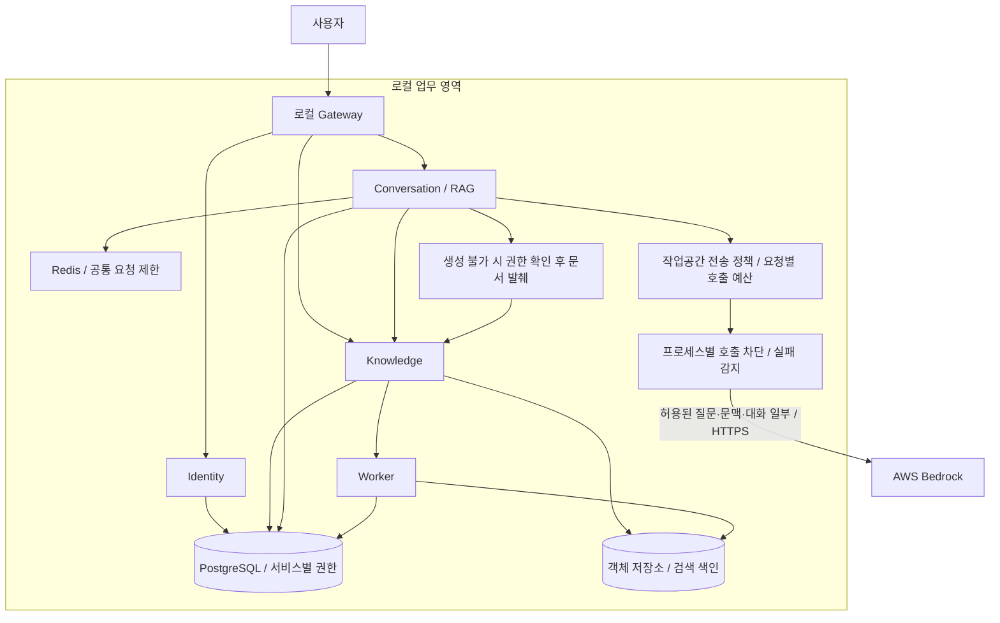
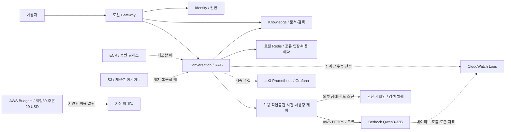

# SecureDoc 하이브리드 운영 구조

업무 데이터·검색·인증은 로컬에 유지하고, 명시적으로 허용된 작업공간의 추론만 AWS Bedrock으로 연결한다. AWS 연결 실패 시 생성 대신 로컬 문서 발췌를 제공한다. `local`과 `multicloud` 저장소의 동작은 이 변경에 포함하지 않는다.

## 구현된 경계

- 외부 추론의 기본 정책은 차단이다. 서버 설정의 정확한 작업공간 UUID만 허용한다. 사용자 요청이나 헤더로 허용할 수 없다.
- 재작성·관련성 판정·생성·출처/근거 검증을 포함한 모델 호출에 같은 정책을 적용한다.
- 연결 실패·시간 초과·429·서버 오류 시 권한을 재확인한 문서 발췌로 전환한다. 제공자 인증·설정 오류는 503으로 노출한다.
- 호출 차단기는 프로세스별이며, 기본 3회 연속 실패 후 30초 동안 새 요청의 클라우드 호출을 막는다. 이후 시험 요청 1개로 복구를 확인한다.
- 외부 추론을 모두 차단한 환경은 AWS 키 없이 기동할 수 있다. 인증·DB·검색·Redis 등 로컬 의존성은 계속 필요하다.
- 검색 전환 모드와 사유는 대화 이력에 저장한다. UI는 발췌를 생성 답변과 구분한다.
- 릴리스 도구는 이미지 ID를 고정해 저장·체크섬 검사·복원하고 registry pull을 금지하는 override를 만든다. DB·원본·모델 가중치 복구 도구는 아니다.

## 아직 운영 구성으로 제공하지 않는 부분

VPN·PrivateLink·다중 AZ·온프레미스 다중 호스트·DB 자동 failover·CloudWatch 전송·이미지 서명 검증은 후속 운영 구성이다. 현재는 사설 네트워크나 AWS 고가용성 구성이 완료됐다고 주장하지 않는다. `docs/hybrid-operations.md`의 검증 범위와 제한을 함께 읽는다.

## 2026-10-19 배포·운영 경계

ECR·S3·CloudWatch·Budgets는 실제 배포·조회 검증했다. 앱 호출 한도는 Redis로 복제본 간 공유하지만 circuit breaker는 프로세스별이다. 배포·관측 자원을 사용자 요청의 동기 의존성으로 추가하지 않았다. 원본을 로컬에 저장해도 허용 작업공간의 검색 문맥·질문은 외부 모델로 전송된다. 현재는 단일 로컬 호스트이므로 호스트 장애까지 막는 고가용성으로 설명하지 않는다. 상세 증거·비용 범위는 [FinOps 안내](docs/hybrid-finops.md)를 참고한다.
